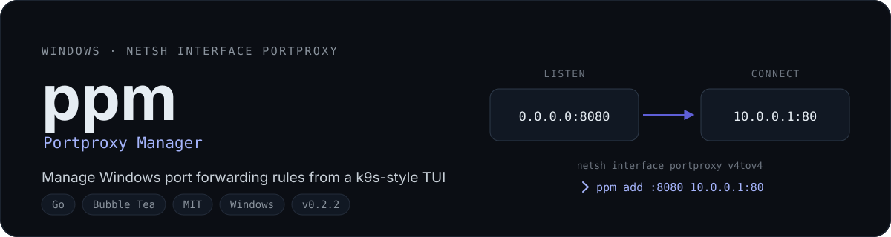
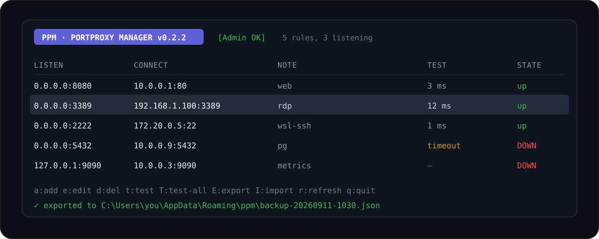
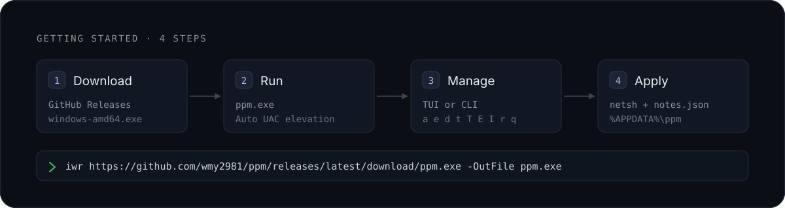
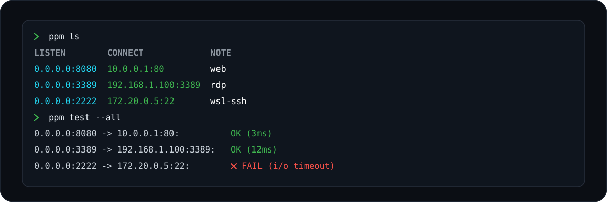

<p align="center">
  <strong>English</strong> | <a href="README.zh-CN.md">简体中文</a>
</p>

<p align="center">
  
</p>

<p align="center">
  <a href="https://github.com/wmy2981/ppm/releases/latest"></a>
  
  
  
</p>

**ppm** turns Windows' `netsh interface portproxy` into a scrollable table: list, add, edit, and delete port forwarding rules from a single terminal UI, with notes, connectivity tests, and listen-state checks built in. One exe, no installer, no runtime dependencies.

> Built for exposing WSL2, Docker, or LAN service ports without memorizing `netsh` flags every time.

## Interface

<p align="center">
  
</p>

## Why ppm

`netsh interface portproxy` gets the job done, but it cannot remember why you added a rule, and it cannot tell you whether that forward actually works right now.

| | `netsh` CLI | ppm |
|---|---|---|
| See all rules | Type `show v4tov4` and read the output | One table, with paging and arrow-key navigation |
| Rule notes | Not supported | `notes.json`, keyed by `listen address:port` |
| Connectivity | Manual `Test-NetConnection` | `t` tests the selected rule, `T` tests all in parallel, showing latency or the error |
| Is it really listening | Check `netstat` separately | Cross-checks netstat, marks `up` / `DOWN` |
| Backup and migration | Copy the commands by hand | `E` exports JSON, `I` imports and dedupes by listen key |
| Scripting | Assemble the command line yourself | CLI subcommands with `--json` output |

## Quick start

One PowerShell command installs the latest release into `%APPDATA%\ppm` and adds it to your user PATH:

```powershell
irm https://raw.githubusercontent.com/wmy2981/ppm/main/scripts/install.ps1 | iex
```

The script asks before it writes anything, offers an optional GitHub mirror when GitHub is slow (off by default), and overwrites an existing install in place — re-run the same command to update. To uninstall:

```powershell
& ([scriptblock]::Create((irm https://raw.githubusercontent.com/wmy2981/ppm/main/scripts/install.ps1))) -Action uninstall
```

Prefer a manual install? Download `ppm-v<version>-windows-amd64.exe` from [Releases](https://github.com/wmy2981/ppm/releases), rename it to `ppm.exe`, and run it from any directory.

Build from source (requires Go 1.26):

```powershell
git clone https://github.com/wmy2981/ppm.git
cd ppm
powershell -File .\scripts\build.ps1
```

<p align="center">
  
</p>

## Usage

Double-click `ppm.exe` or run it from a terminal to enter the TUI. Adding, editing, and deleting rules requires administrator privileges — on startup ppm triggers a UAC prompt and relaunches itself elevated; declining exits.

| Key | Action |
|---|---|
| `a` | Add a rule |
| `e` / `enter` | Edit the selected rule |
| `d` | Delete the selected rule (`y` to confirm / `n` to cancel) |
| `t` | Test connectivity of the selected rule |
| `T` | Test all rules in parallel |
| `E` | Export to `%APPDATA%\ppm\backup-YYYYMMDD-HHMMSS.json` |
| `I` | Import a backup JSON by path (merged and deduped; existing listen keys are skipped) |
| `r` | Refresh the list and listen states |
| `j` / `k`, arrow keys | Move the cursor (pgup / pgdn / home / end also work) |
| `q` | Quit (`y` to confirm / `n` to cancel) |

### CLI

Run `ppm` with no arguments to enter the TUI; passing a subcommand runs it in CLI mode.

<p align="center">
  
</p>

| Subcommand | Alias | Description |
|---|---|---|
| `ppm list` | `ls` | List all rules |
| `ppm add` | - | Add a rule |
| `ppm edit` | - | Edit a rule (delete the old one + create the new one) |
| `ppm delete` | `del` | Delete one or more rules |
| `ppm test` | - | Test rule connectivity |
| `ppm export` | - | Export all rules and notes as a JSON backup |
| `ppm import` | - | Import rules from a backup file |
| `ppm tui` | - | Explicitly launch the TUI |
| `ppm version` | `ver` | Print the version |

| Long | Short | Applies to |
|---|---|---|
| `--listen` | `-l` | `add`, `edit` |
| `--connect` | `-c` | `add`, `edit` |
| `--note` | `-n` | `add`, `edit` |
| `--json` | `-j` | `list`, `test` |
| `--output` | `-o` | `export` |

```bash
ppm ls -j                              # list all rules as JSON

ppm add :8080 10.0.0.1:80              # same as 0.0.0.0:8080 -> 10.0.0.1:80
ppm add :3000 10.0.0.1:3000 web        # with a note
ppm add -l :8080 -c 10.0.0.1:80 -n web # same, using flags

ppm edit :8080 -c 10.0.0.2:80          # change only the target (listen address unchanged)
ppm edit :8080 :9090 10.0.0.2:80       # change both listen address and target

ppm del :8080                          # delete a single rule
ppm del :8080 :9090 :3000              # delete several rules at once

ppm test :8080                         # test a single rule
ppm test -a                            # test all rules

ppm export -o backup.json              # export to a specific file
ppm import backup.json                 # import from a backup file (deduped)
```

## Data location

- Notes and backups: `%APPDATA%\ppm\`
- Notes (`notes.json`) are keyed by `listen address:port` and included in exports

## Notes

- Only v4tov4 mode (IPv4 → IPv4) is supported, which covers the vast majority of cases
- portproxy depends on the `iphlpsvc` system service; if forwarding does not work, check that the service is running first
- Listening on `0.0.0.0` occupies that port on every network interface; a port already in use shows `!off` and will not work
- Editing is "delete the old rule + create the new rule" — `netsh` has no in-place update; ppm attempts a best-effort rollback on failure

## License

[MIT](./LICENSE)
